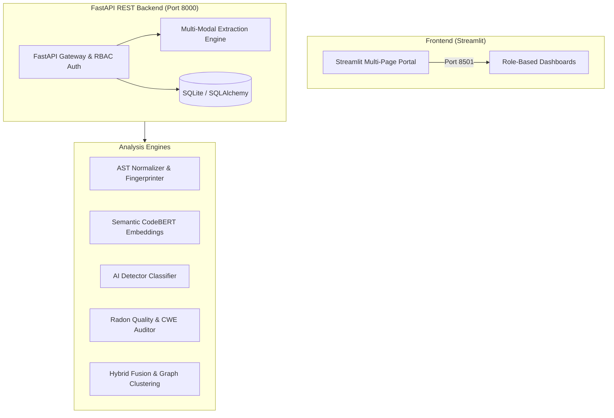

# CodeGuard Platform 🛡️

**CodeGuard Platform** is an enterprise-grade academic code integrity, security auditing, and intelligent plagiarism analysis system. Designed for universities, coding bootcamps, and software engineering faculties, CodeGuard combines AST-based structural inspection, deep semantic embeddings (CodeBERT), machine-learning AI generation detection, and automated CWE security vulnerability scanning into a unified, role-based platform.

---

## 🌟 Key Features

### 1. 🔍 Hybrid Multi-Signal Plagiarism Detection
- **AST Normalization & Structural Fingerprints:** Standardizes identifiers, function signatures, and control flows to detect renamed variables, reordered loops, and structural refactoring.
- **Deep Semantic Embeddings:** Employs pre-trained CodeBERT (`microsoft/codebert-base`) to measure deep semantic and logic similarity regardless of surface syntactic changes.
- **Multi-Factor Fusion Model:** Calibrates AST Jaccard similarity, Tree Edit Distance, and cosine embedding scores into a unified fusion score.
- **NetworkX Cluster Detection:** Groups colluding student submissions into connected clusters for immediate visual inspection by faculty.
- **Assignment & Submission Isolation:** Strict boundaries prevent cross-assignment comparisons and automatically filters older drafts and self-pairs.

### 2. 🤖 ML-Powered AI Code Authorship Detection
- **Trained Classification Pipeline:** Uses an ensemble trained pipeline (`models/ai_detector.joblib`) calibrated against human and LLM-generated codebases.
- **Stylometric & Structural Signals:** Computes AST node distributions, cyclomatic complexity variance, Halstead metrics, and structural docstring patterns.
- **Perplexity & Burstiness Heuristics:** Pinpoints homogeneous, machine-generated coding patterns with actionable risk probability scores.

### 3. 📊 Code Quality & Security Auditing
- **Comprehensive Quality Metrics:** Computes Lines of Code (LOC), Comment-to-Code ratio, Cyclomatic Complexity, and Radon Maintainability Index (MI).
- **Automated Security & CWE Scans:** Identifies common software vulnerabilities (e.g., hardcoded credentials, unsafe execution, weak crypto) and links findings directly to official MITRE CWE definitions.

### 4. 📦 Multi-Modal Bulk Submission Ingestion
- **Multi-Format Extraction:** Automatically extracts and validates code from `.py` scripts, PDF documents (`pdfplumber` / `pypdf`), Word files (`python-docx`), and scanned images/screenshots (Tesseract OCR).
- **Intelligent Student Identification:** Auto-extracts student roll numbers and usernames from filenames and embedded code headers.
- **Custom Assessment Creation:** Teachers can create and name assessments on the fly during bulk upload without pre-configuration.

### 5. 👨‍🏫 Faculty Review Queue & 1-Click Approve / Release
- **Individual Row Action Boxes:** Each row in the faculty audit table features dedicated 1-click **Approve** and **Release** action boxes.
- **Batch Processing:** One-click "Approve All Filtered" and "Release All Filtered" buttons for high-volume assignment workflows.
- **Student Visibility Control:** Students can only view their detailed audit reports once explicitly approved and released by authorized faculty.

### 6. 🔐 Multi-Tier Role-Based Access Control (RBAC)
- **Four Distinct Roles:**
  - **Student:** Submit code, view assignment status, inspect approved reports.
  - **Professor:** Audit assigned sections, run all-vs-all plagiarism detection, approve/release reports, bulk upload.
  - **HOD (Head of Department):** Department-wide analytics, cross-section monitoring, faculty assignment.
  - **Admin:** Full system administration, user provisioning, section mapping.

---

## 🏛️ System Architecture



---

## 📁 Repository Structure

```
codeguard/
├── backend/                  # FastAPI application
│   ├── auth/                 # JWT tokens, password hashing, RBAC dependencies
│   ├── database/             # SQLAlchemy models, CRUD operations, migrations
│   ├── services/             # Analysis orchestrator, similarity & embedding services
│   ├── extraction.py         # Multi-modal extraction (PDF, DOCX, Images, Python)
│   ├── identification.py     # Student username & ID regex parser
│   └── main.py               # REST API endpoints & lifespan handler
├── frontend/                 # Streamlit UI application
│   ├── .streamlit/           # Custom UI themes and configuration
│   ├── components/           # Reusable UI widgets and modal views
│   └── app.py                # Main Streamlit dashboard application
├── modules/                  # Core algorithmic modules
│   ├── ast/                  # AST parser, normalizer, and fingerprinting
│   ├── plagiarism/           # Tree edit distance, Jaccard, and fusion logic
│   ├── ai_detection/         # AI classifier pipeline & heuristics
│   └── quality/              # Radon metrics, LOC, complexity & CWE audit
├── models/                   # Serialized ML models (ai_detector.joblib)
├── datasets/                 # Obfuscation benchmarks and dataset manifest
├── experiments/              # Ablation benchmarks and Whodunit evaluations
├── results/                  # Benchmark metrics, ablation results, and Markdown logs
├── scripts/                  # Data maintenance, indexing, and verification utilities
├── tests/                    # pytest test suite
└── requirements.txt          # Python dependencies
```

---

## 🚀 Getting Started

### Prerequisites
- **Python 3.10+** (Python 3.11, 3.12, 3.13 supported)
- **Git**
- *(Optional)* **Tesseract OCR** (required only if extracting code from screenshots/images)

### 1. Installation

Clone the repository and set up a virtual environment:

```bash
git clone https://github.com/rahulreddy077/CodeGuard_Platform.git
cd CodeGuard_Platform

# Create virtual environment
python -m venv venv

# Activate virtual environment
# Windows:
venv\Scripts\activate
# Linux / macOS:
source venv/bin/activate

# Install dependencies
pip install -r requirements.txt
```

### 2. Starting the Backend API

Start the FastAPI backend with Uvicorn:

```bash
uvicorn backend.main:app --reload --host 127.0.0.1 --port 8000
```

- **Interactive API Documentation (Swagger UI):** `http://127.0.0.1:8000/docs`
- **ReDoc:** `http://127.0.0.1:8000/redoc`

The backend automatically creates all required database tables and seeds demo users, sections, and assignments on initial startup.

### 3. Starting the Frontend Dashboard

In a new terminal window (with the virtual environment activated):

```bash
streamlit run frontend/app.py
```

Open your browser to: **`http://localhost:8501`**

---

## 👥 Default Demo Credentials

The database is pre-seeded with test accounts across all roles:

| Role | Username | Password | Access Scope |
| :--- | :--- | :--- | :--- |
| **Admin** | `admin` | `admin123` | Full administrative control, user & section management |
| **HOD** | `hod` | `hod123` | Department analytics, cross-section monitoring, approvals |
| **Professor** | `professor` | `prof123` | Assigned section review queue, bulk upload, all-vs-all report |
| **Student** | `student` | `stud123` | Submit code, view status, inspect released analysis reports |
| **Demo Student 2** | `demo_student_2` | `password123` | Secondary student account for multi-user testing |

---

## 🧪 Testing & Verification

Run the full automated test suite with pytest:

```bash
pytest tests/ -v
```

Run the end-to-end Teacher Review & RBAC workflow test:

```bash
python test_teacher_dashboard_workflow.py
```

Run the multi-modal extraction validation test:

```bash
pytest tests/test_extraction.py -v
```

---

## 📄 License

This project is licensed under the MIT License - see the LICENSE file for details.
